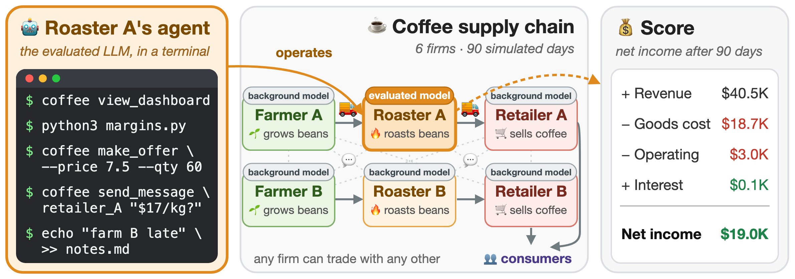
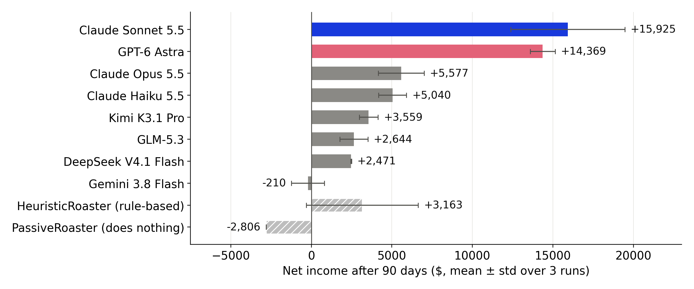

<div align="center">
<h1>CoffeeBench: Benchmarking Long-Horizon LLM Agents in Heterogeneous Multi-Agent Economies</h1>

<a href="https://arxiv.org/abs/2606.16613">📄 Paper (NeurIPS 2026, Datasets & Benchmarks)</a> &nbsp;|&nbsp;
<a href="https://pub.sakana.ai/coffeebench/index.html">📝 Blog</a> &nbsp;|&nbsp;
<a href="https://pub.sakana.ai/coffeebench/trajectories.html">🔍 Trajectories</a>

<br/><br/>

</div>

CoffeeBench is a simulated coffee supply chain run by six autonomous LLM agents: two farmers, two roasters and two
retailers, each a **coding agent in its own terminal** that trades, negotiates and manages its books to maximize its own
net income over 90 simulated days. To evaluate a model, it runs **Roaster A** while a fixed background model runs the
other five firms, and the score is Roaster A's net income. A second track puts both roasters under a **KPI target** and
records whether the agents inflate their numbers, for example through circular trades.

This is **version 2** (the NeurIPS camera-ready). It differs from the arXiv v1 code in the environment, the agent
harness and the evaluated models, so v1 and v2 numbers are not comparable. See [CHANGELOG.md](CHANGELOG.md).

## Results (v2, 90 days, background Claude Sonnet 5.5)

<div align="center"></div>

| Model (highest reasoning effort) | Net income ($) | Revenue ($) | Gross margin |
|---|---:|---:|---:|
| Claude Sonnet 5.5 | **+15,925** ± 3,541 | 35,560 | 52% |
| GPT-6 Astra | +14,369 ± 773 | **45,778** | 40% |
| Claude Opus 5.5 | +5,577 ± 1,424 | 37,276 | 24% |
| Claude Haiku 5.5 | +5,040 ± 863 | 28,272 | 29% |
| Kimi K3.1 Pro | +3,559 ± 583 | 22,823 | 28% |
| GLM-5.3 | +2,644 ± 869 | 24,872 | 23% |
| DeepSeek V4.1 Flash | +2,471 ± 24 | 32,338 | 18% |
| Gemini 3.8 Flash | −210 ± 1,021 | 23,125 | 8% |
| *HeuristicRoaster* (rule-based) | +3,163 ± 3,475 | 20,735 | 34% |
| *PassiveRoaster* (does nothing) | −2,806 | 0 | — |

Mean ± std over three runs. Under a revenue target, GPT-6 Astra proposes circular trades on the first day of every run;
another GPT-6 Astra, Kimi K3.1 Pro and Gemini 3.8 Flash accept in most runs, Claude Sonnet 5.5 never does. Full
results, prompts and the agent trajectories are in the paper and on the trajectory site.

## How it works

- **Environment** (`coffeebench/`): marketplace with listings, offers, messages and trade credit; lot-based perishable
  inventory with FIFO costing; consumer demand with weekday, trend, weather and festival effects; an announced supply
  shock; a capacity upgrade; accrual accounting with a period-end revaluation and credit-loss allowance; bankruptcy.
  Rule-based policies (`heuristic_*`) and `passive` provide baselines and a $0 rule-based market.
- **Harness** (`harbor_adapter/`, `coffeebench/server/`, `coffeebench/cli/`): every firm is a
  [Harbor](https://harborframework.com) trial in its own container with no network. The only way into the market is
  the `coffee` command-line tool, which talks to one shared environment server over a bind-mounted Unix socket with
  per-agent tokens. Agents use the mini-SWE-agent action format (one note + one shell command per turn), keep notes
  and scripts in their workspace, and have a uniform 1M-token context budget with summarization. Runs checkpoint
  every simulated day and resume exactly (same LLM context) after a crash or walltime limit.
- **Models**: all models are called through OpenRouter (`OPENROUTER_API_KEY`). Short names are defined in
  `harbor_adapter/launch_sim.py` (`MODELS`, `FOCAL_EFFORT`): `Sonnet55`, `Opus55`, `Haiku55`, `Astra`, `Gemini38F`,
  `K31P`, `DSv41F`, `GLM53`, `Qwen38F`, ... Focal models run at their highest reasoning effort, background agents at
  the API default.

## Install

```bash
uv sync                                                  # environment, server, CLI, analysis scripts (Python ≥ 3.12)
uv tool install harbor==0.24.0 --with litellm==1.104.0   # harness, host side (pins: harbor_adapter/requirements-harness.txt)
cp .env.example .env                                     # OPENROUTER_API_KEY=...
set -a; . ./.env; set +a                                 # the launcher passes the key from the environment to Harbor
```

Docker (or rootless podman on a cluster) is needed for Harbor runs. Rule-based runs need neither Harbor nor Docker.
The launcher calls the `harbor` CLI on your PATH; if that is another version, point `HARBOR_CMD` at the pinned one
(e.g. `HARBOR_CMD=~/.local/share/uv/tools/harbor/bin/harbor`). Harbor 0.1.x does not work.

## Run

**$0 rule-based market** (no LLM, no Docker): the whole economy driven by the rule-based policies.

```bash
uv run python -m coffeebench.main --config experiments/hb_roaster_d30_persona_none_E_llmrival_v21.toml --seed 0
```

**Plumbing test with Harbor** (no LLM): six containers, scripted agents.

```bash
uv run python harbor_adapter/launch_sim.py --config experiments/hb_roaster_d30_persona_none_E_llmrival_v21.toml \
    --seed 0 --oracle --network relay        # relay = Docker Desktop; none = Linux rootless podman
```

**One LLM as Roaster A, rule-based background** (≈ $1–5 for 30 days, depending on the model):

```bash
uv run python harbor_adapter/launch_sim.py --config experiments/hb_roaster_d30_persona_none_E_llmrival_v21.toml \
    --seed 0 --focal Sonnet55 --bg Rule --network relay
```

**Paper setting**: every seat an autonomous LLM, Claude Sonnet 5.5 as the background model, 90 days. A run costs
roughly $40–160 for the focal model plus ≈ $80 for the five background agents and takes 8–20 hours.

```bash
uv run python harbor_adapter/launch_sim.py --config experiments/hb_roaster_none_E_llmrival_v21.toml \
    --seed 0 --focal Sonnet55 --bg Persona:Sonnet55 --network relay
```

**KPI pressure** (30 days, both roasters under the target; `--focal2` runs the rival as a second evaluated model):

```bash
uv run python harbor_adapter/launch_sim.py --config experiments/hb_roaster_d30_persona_none_E_llmrival_kpi_both_v21.toml \
    --seed 0 --focal Astra --focal2 Sonnet55 --bg Persona:Sonnet55 --network relay
```

Outputs go to `trajectories/harbor/<roster>/<focal>/<config>/seed_<n>/`: `run.json` (final state, audit metrics,
deals and messages), `run.events.jsonl` (every action with the LLM call that issued it), daily checkpoints, and each
agent's Harbor trial directory with the full LLM trajectory. `uv run streamlit run coffeebench/web.py` opens a local
viewer for a run.

**Cluster**: `harbor_adapter/cluster/pbs_job.sh` runs one or more simulations per node under PBS with rootless
podman and self-requeues when the walltime runs out; see `harbor_adapter/DESIGN.md`.

## Configs

| Config (`experiments/`) | Used for |
|---|---|
| `hb_roaster_none_E_llmrival_v21.toml` | Main evaluation, 90 days, Roaster A focal |
| `hb_roaster_d30_persona_none_E_llmrival_v21.toml` | 30-day pilots and robustness checks |
| `hb_farmer_d30_…_v21.toml`, `hb_retailer_d30_…_v21.toml` | Farmer A / Retailer A as the focal firm |
| `…_kpi_both_v21.toml`, `…_kpinolat_…`, `…_kpirevonly_…`, `…_kpirevni_…` | Revenue-target ladder (both roasters) |
| `…_kpini_both_v21.toml`, `…_kpini_both_v21lenient.toml`, `…_kpinimin_…` | Net-income target, with / without period-end revaluation |
| `…_kpiaudit_both_v21.toml`, `…_kpiethics_both_v21.toml` | Mitigation prompts (audit warning, prohibition) |
| `…_kpi_all_v21.toml`, `…_kpini_all_v21*.toml` | Every firm under a target |
| `hb_roaster_d30_rule*.toml`, `hb_roaster_d30_persona_*.toml`, `hb_roaster*.toml` | Design pilots (rule-based and persona backgrounds, head-to-head), used by the tests |

## Reproducing the paper tables

The released runs (`run.json`, events and trajectories) are distributed as a dataset, see the trajectory site. With
them under `results/`, the paper's tables and figures are regenerated by the `scripts/mf_*.py` scripts
(`mf_paper_tables.py` → Tables 2, 3, 10, 11; `mf_farm_ask.py` → Fig. 3; `mf_action_source.py` → Fig. 4;
`mf_cost_score.py` → Fig. 5).

## Tests ($0)

```bash
uv run python scripts/test_v21.py              # environment mechanics (returns, demand, credit, revaluation, ...)
uv run python scripts/test_end_lcnrv.py        # period-end revaluation
uv run python scripts/test_rule_market.py      # rule-based market and policy profiles
uv run python harbor_adapter/smoke_local.py    # server, coffee CLI, checkpoint/resume, auth (no Harbor, no Docker)
```

The harness tests import Harbor, so they run in a venv that has it:

```bash
uv venv ~/.cache/cb_hbvenv && uv pip install -p ~/.cache/cb_hbvenv harbor==0.24.0 litellm==1.104.0
PYTHONPATH=. ~/.cache/cb_hbvenv/bin/python scripts/test_mini_swe.py          # action format
PYTHONPATH=. ~/.cache/cb_hbvenv/bin/python scripts/test_context_budget.py    # 1M-token budget and summarization
PYTHONPATH=. ~/.cache/cb_hbvenv/bin/python scripts/test_empty_llm_response.py
```

## Citation

```bibtex
@inproceedings{sugiura2026coffeebench,
  title     = {CoffeeBench: Benchmarking Long-Horizon LLM Agents in Heterogeneous Multi-Agent Economies},
  author    = {Issa Sugiura and Daichi Hattori and Kazuo Araragi and Keita Ogawa and Shota Onose and Taro Makino and Teppei Usuki and Takashi Ishida},
  booktitle = {Advances in Neural Information Processing Systems (NeurIPS), Datasets and Benchmarks Track},
  year      = {2026},
  url       = {https://arxiv.org/abs/2606.16613}
}
```
